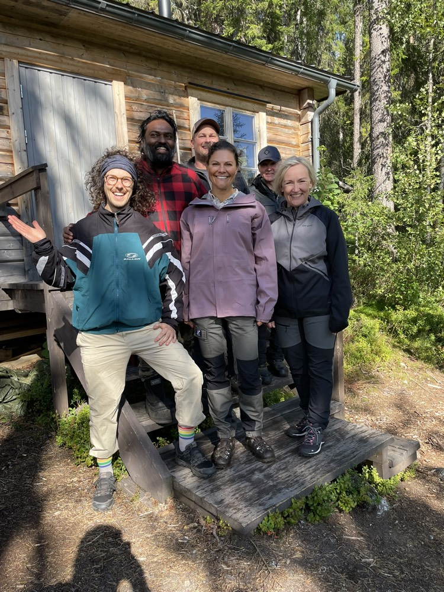

::: article
::: paragraph
::: text

&nbsp;

Once a year I take one long vacation: my attempt at finding my way back to myself through a curated journey of festivals, seminars, humans and nature.

&nbsp;

This summer, I went on a spontaneous survival trip into Sweden’s Björnlandet (“Bear Land”). I always strive to escape civilization (and, this time, a heartbreak) on my own feet: I flew north, took the bus as far as it would go, and headed out with a week of food on my back to hunt and gather real offline time.

&nbsp;

After days of hiking, picking blueberries and occasionally talking to myself, I came across a fully equipped cabin: firewood, a bunk bed and the kind of orderliness you don’t expect in the middle of nowhere. I lit a fire, dried my things and collapsed into bed.

&nbsp;

The next morning, to my surprise, a park ranger and a TV chef woke me up. They were expecting a special guest for lunch, they explained. I asked if I needed to leave. Not necessarily, they said. So I asked if I could stay and help with the preparations. They agreed, and before long we were grilling reindeer and coffee over an open fire.

&nbsp;

Then the guest arrived, and my wilderness retreat turned surreal. Imagine the scenery: me, several days’ hiking distance into the woods, and coming down the hill, audible long before I could see them, photographers, park rangers, bodyguards and people in full military uniform, around 30 in all. In the middle of them: *the special guest*. I stood next to the chef and helped hand out sandwiches with pickled chanterelles and blueberries.

&nbsp;

Once it became clear that the bewildered, unwashed kitchen assistant didn't speak any Swedish, people got curious. At some point I found myself standing in front of the guest, who introduced herself as Her Royal Highness Victoria, Crown Princess of Sweden. We had a brief and lovely chat, I took a photo for my mom and even gave an interview to a local newspaper.

&nbsp;

The ride back to Umeå I spent next to the head of public affairs, two strangers agreeing on mental health practices: reading on paper, and talking to humans in person. The rest of my vacation I spent camping in the city forest. I had gone seeking solitude; somehow, I found a story instead.

### ᕱ

&nbsp;

> *"What a day it was for Lukas Erlenbach, who received an unexpected visit from the Crown Princess on his camping expedition — and was also treated to a meal prepared by the Wild Chef."* — Folkbladet, Västerbotten

:::
::: image
{class="portrait" width="750" height="1000" loading="lazy"} \
:::
:::
:::