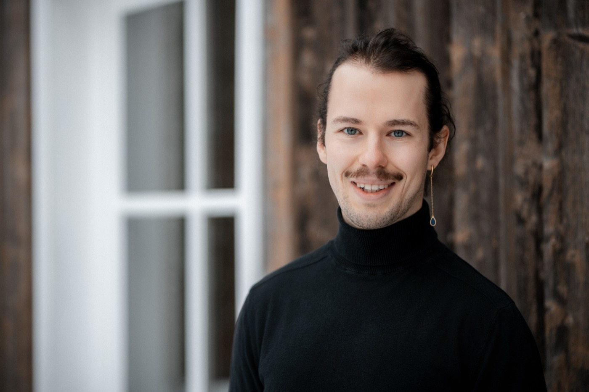

::: article
::: paragraph
::: text

&nbsp;

**Welcome.**

&nbsp;

I'm glad you're here.

&nbsp;

Maybe you know this: pressure to perform. Exhaustion. Restlessness. Thoughts that keep running the same lap. A gut feeling that has gone quiet. Deep down you know there could be more; you just can't get to it.

&nbsp;

Gestalt work offers no quick fixes. It starts with noticing, honestly, what is there right now: in the head, the heart, the belly, the pelvis. That can be practised. From there your own needs come into view, and so do the strategies you use to sidestep them.

&nbsp;

As a mathematician, ultrarunner and management consultant, I know the balancing act between structure and flow: wanting everything under control, and noticing at the same time that life doesn't happen that way. Gestalt has helped me bring control and trust together and regain aliveness.

&nbsp;

If you want change, or have too many options and can't move, I'm glad to accompany you. We work in dialogue, as equals and at your pace; I don't bring advice. Instead we look together at which patterns are in your way and how you can reach your resources again.

&nbsp;

*I am currently in advanced training as a Gestalt therapist at [Irgendwie Anders](https://irgendwie-anders.de/).*

\

*My current offer is strictly limited to **Consulting, Coaching, and Self-Experience** for personal development. I do not offer diagnosis or medical treatment of mental disorders in a clinical sense at this stage.*

&nbsp;

Write to me if you'd like to meet:
.

### 𖦹

&nbsp;

> *"Change occurs when one becomes what he is, not when he tries to become what he is not."*

> — Arnold R. Beisser

:::
::: image
{class="portrait" width="1400" height="933" loading="lazy"} \
:::
:::
:::