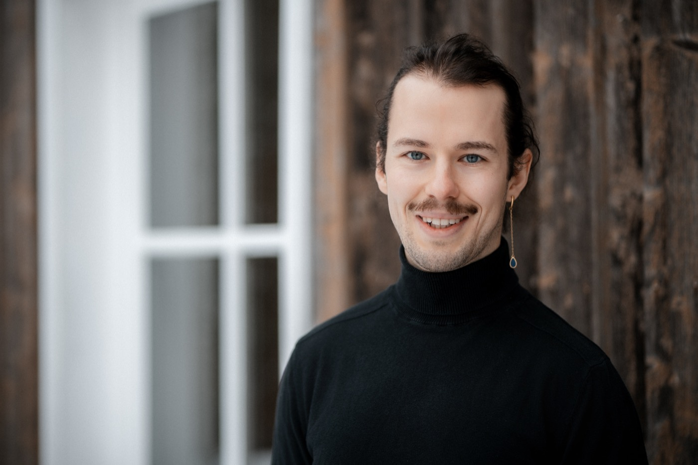

::: article
::: paragraph
::: text

&nbsp;

**Willkommen.**

&nbsp;

Schön, dass Du hier bist. 

&nbsp;

Vielleicht kennst Du das: Leistungsdruck. Erschöpfung. Unruhe. Gedanken, die immer dieselbe Runde drehen. Ein Bauchgefühl, das sich nicht meldet. Eigentlich weißt Du, dass da mehr sein könnte; nur der Zugang fehlt.

&nbsp;

Gestaltarbeit liefert keine schnellen Fixes. Sie beginnt damit, ehrlich wahrzunehmen, was gerade da ist: im Kopf, im Herzen, im Bauch, im Becken. Das kann man üben. Von dort aus werden die eigenen Bedürfnisse sichtbar, und auch die Strategien, mit denen Du ihnen ausweichst.

&nbsp;

Als Mathematiker, Ultraläufer und Unternehmensberater kenne ich den Spagat zwischen Struktur und Flow: alles im Griff haben wollen, und gleichzeitig merken, dass das Leben so nicht stattfindet. Gestalt hat mir geholfen, Kontrolle mit Vertrauen zu verbinden und Lebendigkeit zurückzugewinnen.

&nbsp;

Wenn Du Dir Veränderung wünschst oder vor lauter Optionen nicht weiterkommst, begleite ich Dich gern. Wir arbeiten im Dialog auf Augenhöhe und in Deinem Tempo; Ratschläge bringe ich keine mit. Stattdessen schauen wir gemeinsam, welche Muster Dir im Weg stehen und wie Du wieder Zugang zu Deinen Ressourcen findest.

&nbsp;

*Aktuell befinde ich mich in der fortgeschrittenen Ausbildung zum Gestalttherapeuten bei [Irgendwie Anders](https://irgendwie-anders.de/).*

\

*Mein Angebot umfasst derzeit ausschließlich **Beratung, Coaching und Selbsterfahrung** zur Persönlichkeitsentwicklung auf Spendenbasis.*

&nbsp;

Schreib mir, wenn Du mich kennenlernen magst:
.

### 𖦹

&nbsp;

> *"Veränderung geschieht, wenn jemand wird, was er ist, nicht wenn er versucht, etwas zu werden, das er nicht ist."*

> — Arnold R. Beisser

:::
::: image
{class="portrait" width="1400" height="933" loading="lazy"} \
:::
:::
:::